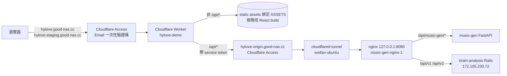

# 公開站部署手冊：Cloudflare Worker `hylove-demo`

> 適用網域：`https://hylove.good-nas.cc`（正式）、`https://hylove-staging.good-nas.cc`（staging）
> 最後更新：2026-11-12（台北時間）

## 先講結論

- **公開站不是由 weifan-ubuntu 上的 nginx（`~/hylove-build`）直接服務的。** 兩個公開網域綁的是 Cloudflare Worker `hylove-demo`，前端檔案是**打包在 Worker 的 static assets 裡**。
- 所以更新 `~/hylove-build`、重啟 nginx、清 Cloudflare 快取，**都不會讓公開站換版**。
- **每一次前端發版，都必須另外部署這個 Worker**（本手冊第 4 節），否則公開站會一直停在舊版。2026-10-25 到 2026-11-12 之間就是這樣：「三地部署」都做了，公開站卻一直送 10/25 的 `main.c4e2d657.js`。

## 1. 架構



| 項目 | 值 |
|---|---|
| Cloudflare 帳號 | `e66ebb93a7088681360856ab5a07b30a` |
| Zone | `good-nas.cc` |
| Worker 名稱 | `hylove-demo` |
| Custom Domains | `hylove.good-nas.cc`、`hylove-staging.good-nas.cc`（兩個都在 Cloudflare Access 後面） |
| workers.dev / Preview URL | 都關閉（不要打開，否則會出現繞過 Access 的入口） |
| Worker 原始碼 | [`cloudflare/worker/index.js`](../../cloudflare/worker/index.js) |
| Wrangler 設定 | [`cloudflare/wrangler.jsonc`](../../cloudflare/wrangler.jsonc) |
| 靜態檔設定 | binding `ASSETS`、`html_handling: auto-trailing-slash`、`not_found_handling: single-page-application`、`run_worker_first: ["/api/*"]` |
| compatibility_date | `2025-10-01` |
| Observability | logs 開啟（取樣 100%，含 invocation logs），traces 關閉 |
| 密鑰 | `CF_ACCESS_CLIENT_ID`、`CF_ACCESS_CLIENT_SECRET`（`hylove-origin` 的 Access service token） |

Worker 的行為：

- 靜態請求（不是 `/api/*`）**根本不會執行 Worker 程式碼**，直接由 assets 回應；找不到的路徑回 `index.html`（SPA fallback）。
- `/api/*` 先進 Worker，轉發到 `https://hylove-origin.good-nas.cc`，加上 service token 標頭，並且**不把使用者的 `CF_Authorization` cookie 往後送、也不把 origin 回來的 `CF_Authorization` 回傳給瀏覽器**。origin 的 Access 拒絕 token 時回 `502 {"error":"origin_auth_failed"}`；連不上時回 `502 {"error":"origin_unreachable"}`。
- 正式站與 staging 用**同一個 Worker、同一份 build**（API 走同源相對路徑，見 README「環境變數」）。

## 2. 事前準備

1. **Node.js 18 以上**、可以執行 `npx`。Wrangler 不放進 `package.json`，一律用 `npx wrangler@4`（本手冊以 4.161.0 驗證過）。
2. **Cloudflare API token**：向主人申請，權限只要：
   - Account `e66ebb93a7088681360856ab5a07b30a` → **Workers Scripts：Edit**（新版權限名稱為該 Worker 的 *Editor*）。
   - Custom Domain 已經設定好了，只要 `wrangler.jsonc` 的 `routes` 沒改，部署**不需要** Zone 權限。若真的要新增／移除網域，才需要額外的 *Zone → Workers Routes → Write*（good-nas.cc），而且要先問過主人。
3. token 只放在當下 shell 的環境變數：

   ```bash
   export CLOUDFLARE_API_TOKEN=********   # 不要寫進 .env、不要 commit、不要貼到 issue / 聊天
   ```

   用完就 `unset CLOUDFLARE_API_TOKEN`。**絕對不要** commit token、`.wrangler/` 目錄或任何密鑰。
4. 確認 token 可用（只讀）：

   ```bash
   npx wrangler@4 whoami
   npx wrangler@4 deployments list --config cloudflare/wrangler.jsonc
   ```

5. **部署公開站屬於改動線上服務，必須先取得主人親自明確的同意。**

## 3. 建置根路徑 build

公開站的網站在根路徑 `/`，必須用 `PUBLIC_URL=/` 建置。**`/demo/` 的 build（台灣 VPS、中國阿里雲用）絕對不能部署到 Worker**，否則 JS/CSS 會指向 `/demo/static/...`，SPA fallback 會回 HTML 而不是 JS，整個頁面白畫面。

注意：weifan-ubuntu 的工作目錄 `~/hylove-demo/build` 常常是中國 `/demo/` 那份 build，不要直接拿來用；要嘛重新建置，要嘛確認它是根路徑。

```bash
# 在 repo 根目錄，切到要發版的 commit（通常是 main）
git checkout main && git pull
npm ci
rm -rf build
PUBLIC_URL=/ npm run build        # 等同 npm run build:vps
```

建置完一定要檢查：

```bash
# 1) 不能出現 /demo/（出現就是錯的 build，不要部署）
grep -c '/demo/' build/index.html            # 必須是 0

# 2) 主程式要是根路徑，記下這個 main.*.js 檔名，部署後要比對
grep -o 'src="/static/js/main\.[0-9a-f]*\.js"' build/index.html

# 3) 檔案真的存在
ls build/static/js/main.*.js
```

> 如果要直接沿用伺服器上已經確認過的根路徑 build（`~/hylove-build`），可以用 `--assets` 覆蓋設定檔裡的目錄：
> `npx wrangler@4 deploy --config cloudflare/wrangler.jsonc --assets ~/hylove-build`
> 一樣要先對 `~/hylove-build/index.html` 做上面三項檢查。

## 4. 部署

一律先 dry run，確認設定、檔案數量、綁定都正確，再正式部署。

```bash
# 4-1 dry run：不會上傳、不會改任何線上東西
npx wrangler@4 deploy --dry-run --config cloudflare/wrangler.jsonc

# 預期看到：
#   ✨ Read NN files from the assets directory .../build
#   env.ASSETS         Assets
#   --dry-run: exiting now.

# 4-2 正式部署（需主人同意）
npx wrangler@4 deploy --config cloudflare/wrangler.jsonc \
  --message "demo-site $(git rev-parse --short HEAD)"
```

- 部署成功會印出新的 **Version ID**，並且 100% 流量切到新版本。記下來，連同上一版的 Version ID 一起寫進發版紀錄。
- `CF_ACCESS_CLIENT_ID` / `CF_ACCESS_CLIENT_SECRET` 已經存在 Worker 上，**`wrangler deploy` 會保留沒寫在設定檔裡的 secret**，不需要、也不要重新設定。dry run 的綁定清單只列 `env.ASSETS`，這是正常的。
- 萬一真的要換 service token：`npx wrangler@4 secret put CF_ACCESS_CLIENT_ID --config cloudflare/wrangler.jsonc`（會產生新版本並立即部署，也要先問主人）。

## 5. 驗證

1. **Cloudflare 端**：

   ```bash
   npx wrangler@4 deployments list --config cloudflare/wrangler.jsonc
   ```

   最新一筆要是剛剛的 Version ID、100%。

2. **瀏覽器端（要登入 Access）**：
   1. 開 `https://hylove.good-nas.cc/`，輸入 Email，到信箱收 `noreply@notify.cloudflare.com` 寄來的驗證碼（10 分鐘內有效，**驗證碼不要貼到任何地方**）。
   2. `Ctrl+Shift+R` 強制重新整理，然後 `view-source:` 或 DevTools → Network，確認載入的 `main.*.js` 檔名**跟第 3 節記下的一樣**。檔名不同就是沒換到版。
   3. staging 也照做一次：`https://hylove-staging.good-nas.cc/`。

3. **UAT 檢查清單**（至少做完這些才算發版完成）：
   - [ ] 首頁與直接開深層路徑（例如重新整理任一分析頁）都正常顯示，沒有白畫面（驗證 SPA fallback）。
   - [ ] DevTools Console 沒有 JS 載入錯誤；Network 裡 `/static/js/main.*.js` 是 200 且 Content-Type 是 JavaScript，不是 HTML。
   - [ ] 呼叫 API 正常（例如跑一次元神音分析），沒有 `502 origin_auth_failed` / `origin_unreachable`。
   - [ ] 元神音（v1）分析完成後，「音樂下載」MP3 可以下載（demo-site #23）。
   - [ ] 作曲參數有「旋律音級重新對應（實驗性）」勾選框，預設不勾。
   - [ ] 靈魂樂 BPM 範圍顯示 40–60。
   - [ ] 雙人模式可以生成並下載 MP3。
   - [ ] 這次發版本身修改的功能。

## 6. 回滾

```bash
# 查版本
npx wrangler@4 versions list --config cloudflare/wrangler.jsonc
npx wrangler@4 deployments list --config cloudflare/wrangler.jsonc

# 回到指定版本（需主人同意）
npx wrangler@4 rollback <VERSION_ID> --config cloudflare/wrangler.jsonc \
  --message "rollback: <原因>"
```

- 回滾會同時換回那個版本的 Worker 程式碼**和** static assets。
- 如果目標版本之後曾經改過 secret，wrangler 可能會提示確認；不論如何，回滾後都要照第 5 節驗證 `/api/*` 與前端檔名。
- 目前的版本紀錄：

  | 版本 | Version ID | 部署時間（台北） | 內容 |
  |---|---|---|---|
  | 現行 | `da904937-fdf6-41a1-8c8a-faa58601eff3` | 2026-11-12 21:42 | demo-site `b53c5a8`，`main.458daeac.js` |
  | 上一版（回滾目標） | `a4c651d7-5152-44e2-a399-a574009b64fc` | 2026-10-25 15:40 | 舊前端 `main.c4e2d657.js` |

  之後每次發版請在這張表最上面加一行。

## 7. 常見陷阱

| 陷阱 | 說明 |
|---|---|
| 以為 nginx / `~/hylove-build` 就是公開站 | 不是。`~/hylove-build` 只透過 `hylove-origin.good-nas.cc` 這條 tunnel 對外，主要給 Worker 轉發 `/api/*` 用。更新它**不會**改變 `hylove.good-nas.cc` 看到的前端。 |
| 只清 Cloudflare 快取 | 沒用。前端檔案在 Worker assets 裡，不是 CDN 快取的 origin 回應。2026-11-12 清過整個主機名的快取，公開站仍是舊版。 |
| 部署 `/demo/` build | 白畫面。`grep -c '/demo/' build/index.html` 必須是 0。`~/hylove-demo/build` 常是中國 `/demo/` 版。 |
| Access 登入 | 兩個網域都在 Access 後面，curl 拿不到頁面，驗證要用瀏覽器登入。驗證碼寄到信箱、10 分鐘過期，不要轉貼。 |
| 第一次用 wrangler 部署會重傳全部 assets | 之前的版本是用 direct-upload API 部署的，wrangler 本地沒有快取，第一次會把整個 build 全部上傳（約 1.3 MB 的 main.js 加其他檔），之後才只傳有變動的檔。這是正常的。 |
| `workers_dev` / `preview_urls` | 設定檔明確設為 `false`。不要刪，否則 wrangler 可能幫你打開 `*.workers.dev`，變成不經 Access 就能看到前端的入口。 |
| 改 `routes` | 只要 `routes` 不變，部署不會碰 Custom Domain。新增／刪除網域需要 Zone 權限，也屬於線上變更，要先問主人。 |
| 把 token 留在檔案裡 | `CLOUDFLARE_API_TOKEN` 只放環境變數；`.wrangler/` 不要 commit。 |

## 8. 發版規則

**每次前端發版（不論是 weifan-ubuntu、台灣 VPS 還是中國）都必須同時部署這個 Worker**，並完成第 5 節的驗證，發版才算完成。發版回報裡要寫：

- demo-site commit
- 公開站 Worker 的新 Version ID 與上一版 Version ID
- 瀏覽器實際載入的 `main.*.js` 檔名
- UAT 檢查清單結果

## 參考

- Worker 原始碼與設定：`cloudflare/worker/index.js`、`cloudflare/wrangler.jsonc`
- Cloudflare 文件：[Static Assets 設定](https://developers.cloudflare.com/workers/static-assets/binding/)、[Wrangler 設定](https://developers.cloudflare.com/workers/wrangler/configuration/)、[Rollbacks](https://developers.cloudflare.com/workers/versions-and-deployments/rollbacks/)、[Workers 權限](https://developers.cloudflare.com/workers/authorization/workers/)
